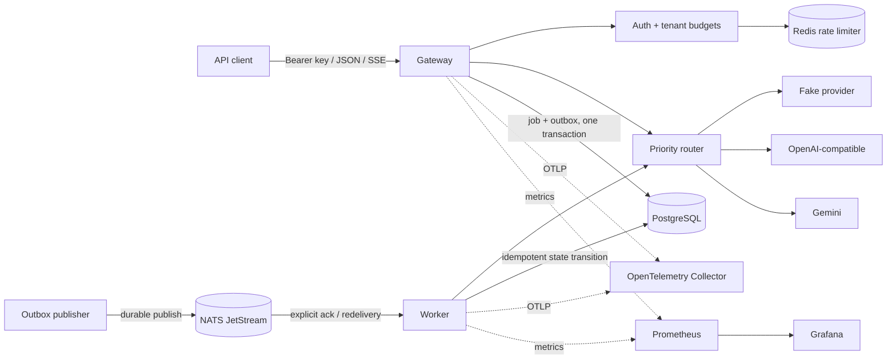

# ForgeGate

ForgeGate is a production-minded, multi-tenant AI gateway and asynchronous job
platform written in Go. It demonstrates the engineering around model calls that
provider SDK demos leave out: tenant isolation, durable acceptance, bounded
failure, duplicate delivery, backpressure, cancellation, telemetry, and an
operable deployment surface.

The repository intentionally starts as one modular codebase with two deployable
processes—`gateway` and `worker`. This keeps transactions and operational
ownership understandable without prematurely turning every boundary into a
network hop.

## Architecture



Request retries, fallback, provider concurrency, circuit state, and load
shedding live in `internal/routing`, rather than being hidden in generic HTTP
middleware. PostgreSQL is the consistency authority; Redis is deliberately
limited to distributed rate limiting; JetStream provides durable at-least-once
delivery.

## Quick start

Requirements: Docker Desktop with Compose v2. Native development uses Go
1.27.2, pinned through `go.mod`; the local stack does not need a paid AI
account.

```bash
docker compose up --build
```

Wait for `http://localhost:8080/health/ready`, then use the local-only seeded
credential:

```bash
curl -sS http://localhost:8080/v1/responses \
  -H 'Authorization: Bearer fg_demo_local_only' \
  -H 'Content-Type: application/json' \
  -d '{"model":"fake/echo","input":"Explain durable acceptance in one sentence."}'
```

On Windows, run `./scripts/demo.ps1`; on macOS/Linux run
`./scripts/demo.sh`. The demo covers synchronous and SSE requests, async job
completion, duplicate idempotency, a rate-limit rejection, and injected provider
fallback.

Local services:

| Service | URL |
|---|---|
| Gateway | `http://localhost:8080` |
| Gateway metrics | `http://localhost:8080/metrics` |
| Worker metrics | `http://localhost:9091/metrics` |
| NATS monitoring | `http://localhost:8222` |
| Prometheus | `http://localhost:9090` |
| Grafana | `http://localhost:3000` (`admin` / `forgegate`) |

Local credentials are public by design and must never be reused outside the
Compose environment. `fg_rate_limit_local_only` belongs to a second tenant with
a two-request/minute limit and is used only by the rejection demo.

## API examples

Normal response:

```bash
curl -sS localhost:8080/v1/responses \
  -H 'Authorization: Bearer fg_demo_local_only' \
  -H 'Content-Type: application/json' \
  -d '{"model":"fake/echo","input":"hello"}'
```

SSE stream:

```bash
curl -N localhost:8080/v1/responses \
  -H 'Authorization: Bearer fg_demo_local_only' \
  -H 'Content-Type: application/json' \
  -d '{"model":"fake/echo","input":"hello","stream":true}'
```

Durable asynchronous job:

```bash
curl -sS localhost:8080/v1/jobs \
  -H 'Authorization: Bearer fg_demo_local_only' \
  -H 'Idempotency-Key: order-42-summary-v1' \
  -H 'Content-Type: application/json' \
  -d '{"model":"fake/echo","input":"summarize order 42"}'

curl -sS localhost:8080/v1/jobs/JOB_UUID \
  -H 'Authorization: Bearer fg_demo_local_only'
```

Every error has a stable code and request ID. Inputs are size-limited and
unknown JSON fields are rejected.

## Reliability model

- Every provider call has a context deadline and tenant/provider concurrency cap.
- Only normalized transient, timeout, unavailable, and rate-limit errors retry.
- Retry count is bounded and uses exponential backoff with deterministic jitter.
- Priority fallback and per-provider circuit breakers prevent repeated calls to
  known-bad dependencies.
- Saturated provider capacity is rejected instead of building an unbounded queue.
- Gateway and worker drain through signal-aware shutdown paths.
- The worker fetches bounded batches, explicitly acknowledges messages, and
  dead-letters exhausted jobs.
- Replayed messages cannot re-run a completed/cancelled/failed job transition.

See [docs/architecture.md](docs/architecture.md) for invariants and
[docs/runbook.md](docs/runbook.md) for failure procedures.

## Data consistency

Job creation, idempotency, budget reservation, and outbox insertion occur in one
PostgreSQL transaction. The publisher may publish more than once if it crashes
after JetStream accepts a message but before `published_at` is committed. That is
intentional: the worker claims work through a conditional database transition,
making duplicate delivery safe.

Schema migrations are compiled into the binaries and protected by a PostgreSQL
transaction advisory lock, so rolling starts cannot apply the same migration
concurrently.

## Security posture

- API keys are compared as SHA-256 hashes; plaintext keys are not stored.
- Provider credentials come from environment/Secret references, never provider
  configuration rows.
- Logs contain request IDs and operational metadata, not API keys or full prompts.
- Request records store an input hash. Async prompts remain in the job payload
  because the worker needs them; production storage should use encrypted volumes,
  short retention, and database access controls.
- Tenant IDs scope all externally addressable job reads and cancellations.
- Security-sensitive provider mutations have a transactionally coupled audit event.
- Containers run as UID 10001 and the Helm workloads drop Linux capabilities and
  use read-only root filesystems.

The full analysis is in [docs/threat-model.md](docs/threat-model.md).

## Observability

The gateway and worker emit structured JSON logs, bounded-cardinality Prometheus
metrics, and OpenTelemetry traces across HTTP, pgx, Redis, NATS propagation, job
processing, and provider attempts. The provisioned Grafana dashboard covers HTTP
RED metrics, provider outcomes/fallback, rate-limit rejection, and job health.

Screenshot placeholder: add a captured `ForgeGate Overview` dashboard image here
after running a representative test. No synthetic screenshot or performance
claim is checked in.

## Testing

```bash
go test ./...
go test -race ./...
go test -tags=integration -v -timeout=10m ./tests/integration
k6 run loadtest/steady.js
```

The integration suite uses Testcontainers for real PostgreSQL, Redis, and NATS.
It verifies migration/seed behavior, API-key lookup, distributed limiting,
idempotent job creation, outbox publication, explicit delivery, duplicate-safe
claiming, completion, and cancellation. All normal tests use the fake provider;
CI never invokes a paid model API. k6 scenarios cover steady, SSE, rate-limit,
async, spike, and fallback traffic with explicit thresholds.

No throughput, latency, availability, or cost result is claimed in this README.
See [docs/load-testing.md](docs/load-testing.md) for the recording template and
[docs/validation.md](docs/validation.md) for the local verification record.

## Deployment

The production Dockerfile builds a static binary and runs it as a non-root user.
The Helm chart includes separate Deployments/Services, probes, resource bounds,
PDBs, HPAs, Secret references, a migration hook, and NetworkPolicy:

```bash
kubectl create secret generic forgegate-secrets \
  --from-literal=FORGEGATE_DATABASE_URL='postgres://...' \
  --from-literal=FORGEGATE_REDIS_PASSWORD='...'
helm upgrade --install forgegate deployments/helm/forgegate
```

`infra/terraform` is an opt-in AWS foundation. Its default plan creates zero
resources and needs no cloud credentials. See its README before enabling it.

## Dependency choices

- `chi`: small, standard-library-shaped routing without a framework lifecycle.
- `pgx`: native PostgreSQL types, pooling, transactions, and query tracing.
- `go-redis`: maintained Redis client with OpenTelemetry hooks.
- `nats.go`: official JetStream client with explicit ack controls.
- OpenTelemetry and Prometheus official clients: vendor-neutral traces and
  scrape-native metrics.
- Testcontainers: integration coverage against actual dependency behavior.

Interfaces exist only at boundaries that need substitution (providers, routing
configuration, outbox/worker stores, and observers), not around every function.

## Honest project status

Implemented and locally testable:

- authenticated JSON/SSE gateway and deterministic fake provider;
- Gemini and OpenAI-compatible adapters;
- tenant rate/request/cost controls and provider routing configuration;
- retries, fallback, circuit breaking, concurrency bounds, and load shedding;
- transactional outbox, JetStream worker, cancellation, retry, and DLQ paths;
- metrics, logs, traces, Compose, Helm, Terraform foundation, CI, and k6 suites.

Known follow-ups:

- External-provider contract tests require disposable sandbox credentials and are
  intentionally excluded from CI.
- Pricing must be configured per provider; unknown pricing records zero cost.
- Running-job cancellation is cooperative at state boundaries; cross-process
  immediate cancellation would need a cancellation subject or shared lease.
- The local collector logs traces but does not bundle a persistent trace backend.
- The AWS Terraform is a safe data-plane foundation, not a turnkey ECS/NATS
  production environment.
- Benchmark/SLO evidence remains blank until tests run on named hardware.

## Documentation map

- [Architecture](docs/architecture.md)
- [Runbook](docs/runbook.md)
- [Proposed SLOs](docs/slo.md)
- [Threat model](docs/threat-model.md)
- [Load testing](docs/load-testing.md)
- [Incident simulation](docs/incident-simulation.md)
- [Architecture decisions](docs/adr/)

## Roadmap

Near-term work is a control-plane API with RBAC and audited key rotation,
reservation-based provider cost estimates, immediate distributed cancellation,
a persistent trace backend, configurable cache opt-in for deterministic models,
and measured capacity envelopes for a specific deployment profile.
